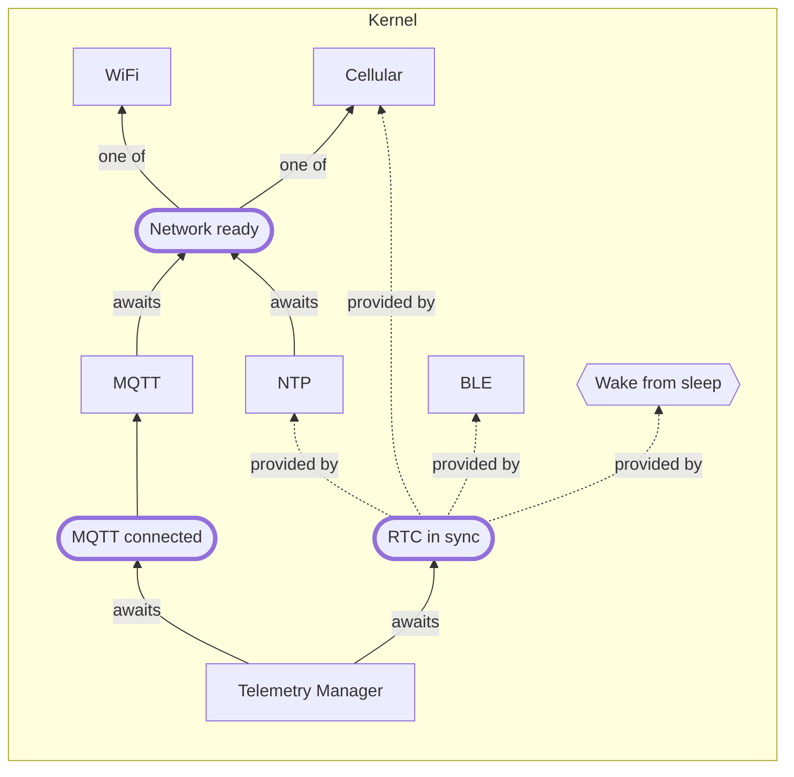
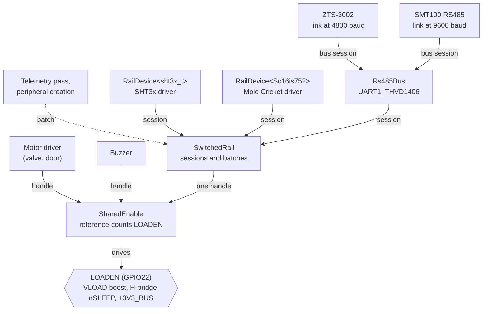
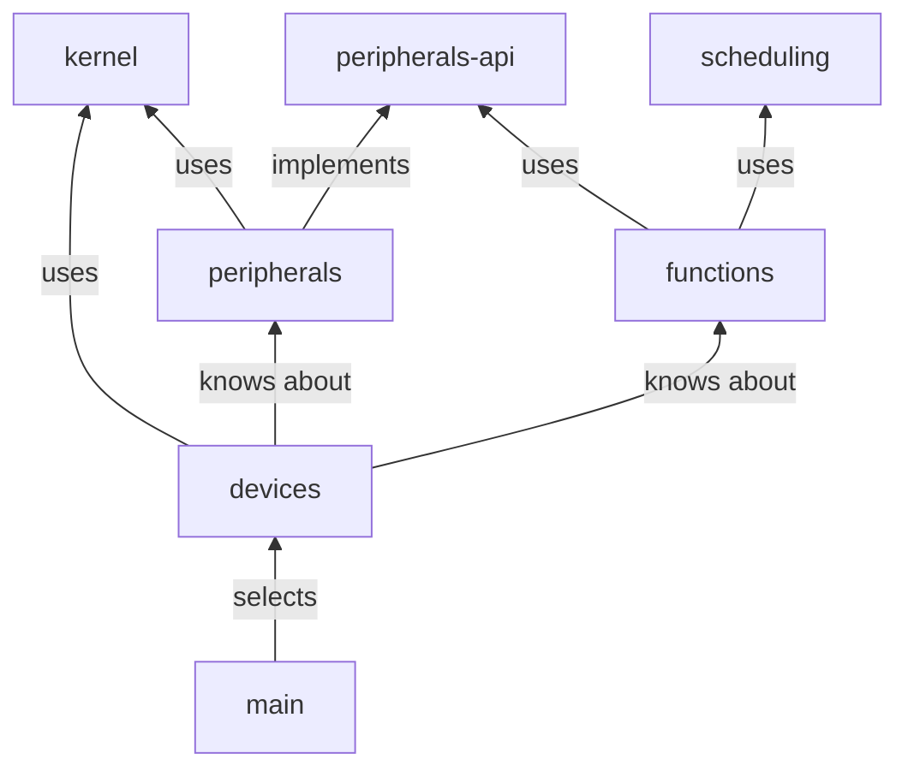

# Architecture

## System layers

The firmware is organized into five conceptual layers, from low-level to high-level:

```
┌──────────────────────────────────────────┐
│               Functions                  │  PlotController, ChickenDoor
├──────────────────────────────────────────┤
│              Peripherals                 │  Sensors, valves, motors, displays
├──────────────────────────────────────────┤
│          Peripheral factories            │  Create peripherals from JSON config
├──────────────────────────────────────────┤
│         Device (hardware model)          │  Pin assignments, on-board drivers
├──────────────────────────────────────────┤
│               Kernel                     │  WiFi, MQTT, NTP, Telemetry
└──────────────────────────────────────────┘
```

## Kernel

The kernel provides the shared runtime services every device relies on:



Key services:

- **BLE** (`BleDriver`) — starts NimBLE unconditionally at boot; advertises the device and hosts the standard Device Information Service (DIS, UUID 0x180A). Future roles: provisioning and local-only (WiFi-free) operation.
- **Network link** — WiFi (`WiFiDriver`) or cellular, LTE-M or NB-IoT (`CellularDriver`), chosen at boot from network-config; either one sets the `networkReady` state (and `networkConnecting` while it gets there). See [Connectivity.md](Connectivity.md).
- **MQTT** — connects to the broker once the network is up, over whichever link is in use; publishes `MQTTConnected`.
- **NTP** — synchronizes the RTC after the network comes up, over WiFi; cellular takes the time from the network (NITZ), or SNTP over a modem socket. See [Time acquisition](#time-acquisition).
- **TelemetryManager** — collects telemetry from registered providers and publishes it once MQTT and the RTC are both ready.
- **PowerManager** / **BatteryManager** — optional battery monitoring and sleep management.
- **NVS** / **Configuration** — persistent key-value store for device and network config.

## Time acquisition

Boot blocks on the `RTC in sync` state before any peripheral is initialized (`Device.hpp`), so
everything downstream can assume a real wall-clock time. This matters for scheduling as much as for
telemetry: a schedule evaluated against time-since-boot would fire at the wrong moment, and the
server keys telemetry rows on the timestamp the device itself reports.

`RtcDriver` signals that state from three sources:

| Source | When | Availability |
| ------ | ---- | ------------ |
| Retained RTC | Immediately at construction, if the clock survived the reset | Soft reset only — a power cycle loses it |
| SNTP | Once the network is up | All platforms |
| BLE Current Time Service | Whenever an external central pushes a time | Carrot only — BLE is disabled on Spinach |

**The state is armed on the clock, never on the outcome of a call.** Every path checks `isTimeSet()`
— the system clock is past 2022-01-01 — before signalling, because a sync can report success while
leaving the clock near the boot epoch. `StateSource` is a one-way latch that nothing clears, so
arming it on a bad clock would permanently mark the device as holding good time: it would keep
publishing, and every status the server can see would look healthy while the timestamps read 1970.

### SNTP servers

Three server slots are configured, tried in order:

| Slot | Server |
| ---- | ------ |
| 0 | Supplied by DHCP, if the lease offers one |
| 1 | `ntp.host` from `network-config.json`, if set |
| 2 | `pool.ntp.org` |

The split exists because lwIP writes DHCP-supplied servers starting at slot 0 and NULLs out every
slot after them. Reserving slot 0 for DHCP (`index_of_first_server = 1`, with
`CONFIG_LWIP_DHCP_MAX_NTP_SERVERS` pinned to 1) lets esp-netif restore ours behind it on each new
lease, so a DHCP offer takes precedence without ever becoming the only option.

### Lifecycle

The SNTP client is initialized in `RtcDriver`'s constructor — before WiFi associates, since lwIP
only keeps the NTP server from a DHCP lease if DHCP server mode is already enabled when that lease
is processed — and started once the network is ready. It then stays alive for the lifetime of the
device, and a task observes its sync notifications rather than driving the retries itself:

- First request after a random 0–5 s delay (`CONFIG_LWIP_SNTP_MAXIMUM_STARTUP_DELAY`), which keeps a
  fleet rebooting together from hitting the public pool in one burst.
- Failed requests retry from 15 s, doubling up to 150 s.
- After a successful sync, lwIP re-polls hourly (`CONFIG_LWIP_SNTP_UPDATE_DELAY`).

Sync mode is `SNTP_SYNC_MODE_IMMED`: every correction steps the clock with `settimeofday()`. Smooth
sync (slewing with `adjtime()`) is deliberately **not** used. It is documented to fall back to
stepping beyond a 35 minute delta, but that fallback is broken in ESP-IDF 6.1
([espressif/esp-idf#19051](https://github.com/espressif/esp-idf/issues/19051)) — `adjtime()` narrows
`tv_sec * 1000000` to a 32-bit `long`, so a cold boot's ~57 year delta wraps to a small value that
slips past the range check meant to reject it. `adjtime()` then reports success, lwIP concludes it
is slewing and never steps the clock, and the slew is abandoned anyway because the boot time is
still zero. The clock stays at time-since-boot indefinitely, and because nothing ever sets the boot
time, every later sync repeats it.

The same overflow would apply to any delta over ~35 minutes, not just a cold boot, so stepping stays
in force once time is acquired rather than switching to slewing: an RTC that drifts that far during
a long network outage would otherwise fail the same way, but silently, since the resulting clock
looks plausible enough to pass the gate.

Keeping one client alive is deliberate. Tearing it down and rebuilding it per attempt discards the
resolved server address and lwIP's retry state, which is what previously left devices unable to
acquire time until they were power-cycled.

### Diagnostics

Time problems are hard to reconstruct after the fact, so the failure path logs what distinguishes
the causes: the error code from each sync wait, every server slot with its RFC 5905 reachability
register (whether requests went out and whether anything answered), the time value a server actually
sent, and — for every arming of `RTC in sync` — which source armed it and what the clock read at
that moment.

## Task stacks

Every task's stack is allocated from internal RAM, so oversized stacks eat directly into the heap
headroom that MQTT messages, TLS and config updates need at runtime. Size them from measurements,
not guesswork.

### Measuring

Debug builds (`CONFIG_FREERTOS_USE_TRACE_FACILITY=y`, set in `sdkconfig.debug.defaults`) log every
task's stack high-water mark after each telemetry publish, least headroom first:

```text
D (131983) ud:global: Task stack high-water marks (bytes unused): ipc0=352, status-update=472, ...
```

The high-water mark is the least stack a task has had unused since boot, so read it only after the
device has been through its busy paths in a single boot: an MQTT reconnect over TLS, a device-config
update, an OTA, and a WiFi drop and reconnect. Short-lived tasks (`mqtt:incoming-handler`,
`update`, `shutdown`) don't appear in the list while they aren't running.

### Sizing

Sizes are shared by both platforms, so size for **Spinach**: Xtensa's windowed register ABI and
larger interrupt frames make the same code use about **1.5×** the stack it does on Carrot's RISC-V
core (1.4–1.8× observed, highest for the smallest tasks). Keep at least 30% of the stack unused on
Spinach, and more for tasks that parse JSON or whose worst case is rare.

A Spinach build running in Wokwi matched real Spinach hardware to within about 100 bytes for most
tasks, so it is a reasonable proxy. It does not exercise TLS (the local Mosquitto is plain MQTT),
real WiFi reconnects, or OTA.

### Observed usage

Bytes used (stack size minus high-water mark), measured in September 2026 with debug builds:

| Task                    | Stack | Carrot (Mk13) | Spinach (MK8) | Spinach (Wokwi, MK6) |
| ----------------------- | ----- | ------------- | ------------- | -------------------- |
| `mqtt:incoming-handler` | 8192  | 4240 ¹        | –             | –                    |
| `mqtt_task` (esp-mqtt)  | 6144  | 4240          | 3724          | 3584 ²               |
| `mqtt`                  | 5120  | 2572          | 2988          | 2976                 |
| `telemetry`             | 5120  | 1428          | 2096          | 2160                 |
| `plot`                  | 4096  | 1804          | 2516          | 2744                 |
| `wifi-driver`           | 4096  | 1420          | 2616          | 1988                 |
| `mqtt:log`              | 3072  | 1544          | 2328          | 2328                 |
| `sync`                  | 4096  | 1552          | 2196          | 2300                 |
| `mqtt:incoming`         | 4096  | 1476          | 2088          | 2052                 |
| `status-update`         | 3072  | 1016          | 1576          | 1676                 |
| `ntp-sync`              | 3072  | 1176          | 1716          | 1716                 |
| `flow-meter`            | 3072  | 584           | 1736          | 984                  |
| `battery`               | 3072  | 864           | 1508          | 1572                 |
| `battery-monitor`       | 3072  | 1208          | –             | –                    |
| `switch-manager`        | 3072  | 1124          | 1092          | 1104                 |
| `status`                | 2048  | 688           | 1176          | 1224                 |

¹ During a device-config update. ² No TLS in Wokwi.

## Device (hardware model)

Each hardware revision is a concrete C++ class that:

- Declares pin assignments and on-board peripherals (status LED, PWM channels, I2C buses).
- Registers a `BatteryManager` if the board has a battery.
- Provides peripheral factories used by `PeripheralManager`.

The active device class is selected at boot:

1. **Compile-time override (`UD_GEN`)** — pass e.g. `-DMK7` to force a specific model; useful for Wokwi simulation.
2. **Runtime MAC detection** — `main.cpp` checks the device MAC address prefix and instantiates the matching class.
3. **Fallback** — `GenericDevice` is used with a warning if the MAC is not recognized.

### Platform and model matrix

| Platform | ESP-IDF target | Models |
| -------- | -------------- | ------ |
| **Spinach** | `esp32s3` | MK5, MK6 (rev1–rev3), MK7, MK8 (rev1–rev2), MK9 rev1 |
| **Carrot** | `esp32c6` | MK10, MK11, MK12, MK13, MK14 (all rev1) |

Each platform produces a single firmware binary. The model and revision are reported in boot logs and in the MQTT `init` message.

### Switched sensor supply

From MK14 on, the external I²C port and the RS485 transceiver run off `+3V3_BUS`, a load switch on
LOADEN (GPIO22). The same pin enables the 6.5 V VLOAD boost and wakes the H-bridge, so the sensor
ports are powered exactly when LOADEN is. Earlier boards power their sensors all the time.



Three classes in `kernel/drivers` build on each other:

- **`SharedEnable`** owns the pin. Every client (motor driver, buzzer, sensor supply) holds a
  handle. LOADEN is on while any handle is acquired, and goes off when the last one is released.
  `acquire()` returns once LOADEN has been on for the 5 ms settle time, so a client that comes in
  while LOADEN is already on only waits for whatever remains of it.
- **`SwitchedRail`** is the sensor supply. Peripherals reach it as `PeripheralServices::switchedRail`
  and hold a `Session` while they talk to a sensor. Each session also tells the sensor driver which
  power-up it runs in (its *activation*), and `waitPoweredFor()` waits out a sensor's own start-up
  time. Time the rail has already been on, for any client, counts towards that wait. MK14 creates
  the rail from its LOADEN `SharedEnable`; every other board uses `SwitchedRail::alwaysOn()`, whose
  sessions never wait and whose activation never changes.
- **`RailDevice<T>`** wraps one sensor on the rail. It owns whatever the driver talks to the
  sensor through (an I²C descriptor, an `I2CDevice`, a bridge chip), and hands it out only from
  `power()`, so a driver built on it can't reach its sensor without powering the rail: forgetting
  to, which would still work on MK13 but fail on MK14, doesn't compile. `power()` opens a session, waits for the sensor's
  start-up time, and re-runs the driver's power-on setup whenever the activation has changed since
  it last ran, because sensors lose their settings when the rail goes off. On an always-on rail
  that setup runs exactly once, at creation, as it did before. `unpowered()` gives access without
  power, only for setting up and freeing the driver's own descriptor.
- **`Rs485Bus`** is the board's RS485 port, which every RS485 probe shares (see
  [RS485 sensors](#rs485-sensors)). It isn't a `RailDevice`: each of its sessions takes a rail
  session of its own.

A `Batch` keeps the rail on between sessions without turning it on by itself. Peripheral creation
and each telemetry pass run inside one, so all the sensors share one power-up, and a device with
no sensors on the rail never turns it on.

#### One reading

What happens when a telemetry pass reads a sensor on MK14 while the rail is off:

1. The telemetry pass opens a batch. Nothing switches on yet.
2. The first sensor's driver calls `railDevice.power()`. Its session takes the rail's handle on
   LOADEN, which turns LOADEN on (unless the valve or buzzer already has it), and waits for the
   5 ms settle time.
3. `power()` waits until the rail has been on for the sensor's start-up time, then sees a new
   activation and runs the sensor's power-on setup.
4. The driver talks to the sensor through the guard `power()` returned. When the guard goes out of
   scope, the session ends, but the batch keeps the rail on.
5. The next sensors find the rail on: they only wait for whatever is left of their own start-up
   time, then run their setup, since this is a new activation for them too.
6. The batch ends with the telemetry pass, releasing the rail's handle. LOADEN goes off unless the
   valve or buzzer still holds it.

The next pass is a new activation, so every sensor is set up again. On boards whose rail is always
on, steps 2, 3 and 6 do nothing, and setup only ever runs at creation.

#### Writing a driver for a port sensor

Any peripheral on the external I²C port should be built on `RailDevice` (for RS485 probes, see
[RS485 sensors](#rs485-sensors)), using `PeripheralServices::switchedRail`:

```cpp
// Member: owns the descriptor; the lambda runs after every power-up
RailDevice<sht3x_t> railDevice;

// Constructor
, railDevice(rail, POWER_UP_TIME, [](sht3x_t& sensor) -> Result<> {
    ESP_TRY(sht3x_init(&sensor));
    return {};
})

// Creating the sensor: set up the descriptor without power, then power it once to find out early
// whether it answers
ESP_TRY(sht3x_init_desc(&sensor->railDevice.unpowered(), ...));
TRY(sensor->railDevice.initialize());

// Reading it
auto device = TRY(railDevice.power());
TRY(device->readRegWord(...));
```

- Pass `NO_POWER_ON_SETUP` instead of the lambda when the sensor keeps no settings we change.
- Extra arguments after the setup construct the `T` in place, e.g. an `I2CDevice` or a bridge chip.
- A `T` that is a smart pointer is reached through: `device->readReg(...)` on a
  `RailDevice<std::shared_ptr<I2CDevice>>`.
- Where a read turns errors into NaN instead of returning a `Result`, check the result of
  `power()` and use `(*device)->...`.
- Use `unpowered()` only for setting up and freeing the driver's own descriptor, never to talk to
  the sensor.
- Keep the guard for as long as the sensor has to stay powered, e.g. while waiting for a
  measurement to finish.

| Peripheral | Start-up wait | Set up again after each power-up |
| --- | --- | --- |
| SHT3x | 1.5 ms | Status cleared |
| SHT2x / HTU2x | 15 ms | Nothing to set up |
| HDC2010 | 3 ms | On-demand mode |
| Chirp | 1 s | Nothing to set up |
| Spadefoot Toad | 100 ms | Nothing to set up (settings in its EEPROM) |
| BH1750 | none | Continuous mode, then one 24 ms measurement |
| TSL2591 | none | Gain and integration time, then one 300 ms integration cycle |
| Mole Cricket (SMT100) | none | UARTs and GPIOs; the probe's own 500 ms start-up follows |
| ZTS-3002 (RS485) | 1 s | Nothing to set up |
| SMT100 (RS485) | 500 ms | Nothing to set up |

**Light sensors read once a minute by default.** BH1750 and TSL2591 run their own reading loop
instead of reading on demand, and every reading powers the rail.

**Valves and sensors share LOADEN without locking each other out.** The I²C sensors draw from
`+3V3_BUS`, which comes off the main 3.3 V rail, not off VLOAD, so a valve pulse during a reading
costs at most a failed reading. RS485 probes are different: the port's eFuse lets them draw up to
1 A from VLOAD, and that plus about 0.5 A of coil current exceeds the boost's worst case on a
depleted cell. The probes supported so far draw far less (the SMT100 ~5 mA, ~40 mA for under
50 ms), so this doesn't matter yet. RS485 sessions don't exclude valve moves
([#726](https://github.com/cornucopia-machines/ugly-duckling-firmware/issues/726));
`SwitchedRail::acquire()` is where they should start to.

#### RS485 sensors

RS485 probes reach the board's port through `Rs485Bus` (MK14: UART1 behind the THVD1406) rather
than `RailDevice`:

- **The bus is shared.** UART1 and the transceiver serve every probe on both ports, so no probe can
  own them. A session holds the bus's mutex for the whole exchange, because the bus is half-duplex
  and each probe needs the UART at its own baud rate. A `RailDevice` only locks its power-on setup.
- **The pins follow the rail.** A session powers the rail first, then attaches the UART to the
  pins. It detaches them before it releases the rail: the transceiver's logic inputs pull up to its
  own supply, so an idle-high TX would back-power it while the rail is off. `RailDevice` has no hook
  at the end of a session for that.
- **Nothing to set up again.** The UART's settings live in the ESP and survive the rail going off,
  and the probes we support keep theirs. A session also holds a no-light-sleep lock, since light
  sleep would stop the UART mid-frame.

A probe still can't be reached without powering the rail: the only way to an `ISerialPort` is
`ISerialLink::open()`, which takes a rail session.

The board provides the bus through `DeviceDefinition::getRs485Bus()`. MK14 creates its `Rs485Bus`
the first time a peripheral asks for it; on every other board the call fails, so an RS485 probe
fails to start there with a clear message. The RS485 factories (`soil:zts-3002`, and `soil:smt100`
with `bus: rs485`) are registered on every board and receive a `SerialBusProvider` that calls it.

A driver for an RS485 probe gets a link at its baud rate, then opens a session per reading:

```cpp
// Creating the sensor
auto bus = TRY(rs485());
auto link = bus->link(9600);

// Reading it
auto session = TRY(link->open());
// Counts the time the rail was already on, as with RailDevice
session->waitPoweredFor(startupTime);
TRY(session->flushRx());
TRY(protocol->read(*session));
```

Protocols are written against `ISerialPort`, so the same code runs over Mole Cricket and RS485:
the SMT100's ASCII protocol uses both, and `ModbusRtu` is available to any Modbus probe.

## Peripherals and functions

See [Components.md](Components.md) for the full conceptual model. In brief:

- A **peripheral** is a physical element connected to the device (sensor, valve, motor).
- A **function** is a logical grouping of peripherals that implements a real-world capability (e.g. `PlotController`, `ChickenDoor`).
- `PeripheralManager` reads the device config from NVS and uses peripheral factories to instantiate peripherals at runtime. It also registers each peripheral as a telemetry provider with `TelemetryManager`.

## Scheduling

The `scheduling` component contains independent scheduling strategies used by `PlotController`:

- `TimeBasedScheduler` — fixed daily schedule.
- `MoistureBasedScheduler` — responds to soil moisture levels (optionally with a Kalman filter).
- `LightSensorScheduler` — responds to ambient light (used by `ChickenDoor`).
- `DelayScheduler` — simple delay-based control.
- `CompositeScheduler` / `OverrideScheduler` — combine and override other schedulers.

## MQTT topic structure

The device's MQTT topic root depends on whether it has been re-addressed (see
[`specs/device-readdressing.md`](specs/device-readdressing.md)):

```
d/$ID/                                     ← device root (re-addressed devices)
    boot                                   ← boot announcement, diagnostics
    sync                                   ← fingerprint manifest of applied config
    update                                 ← incoming configuration
    telemetry                              ← periodic telemetry (all features)
    log                                    ← log records (see below)
    commands/$COMMAND                      ← retained command messages
    responses/$COMMAND                     ← command responses
```

Legacy devices still pending migration use `/devices/ugly-duckling/$INSTANCE/` as the topic root.

See [Configuration.md](Configuration.md) for how `boot`/`sync`/`update` reconcile configuration.

## Log records

Every log line at or above the `publishLogs` level (device config; `Info` in release builds, `Verbose` in
debug builds) is published to `log`, one message per line, at **QoS 1, fire-and-forget**:

```json
{ "session": 42, "seq": 1234, "level": 4, "message": "WiFi connected" }
```

| Field | Meaning |
|---|---|
| `session` | The device's boot count, persisted in NVS (`boot` namespace, `count` key) and incremented once per boot, early in startup. The same number is reported as `bootCount` in BOOT. First boot is 1; 0 means NVS could not be opened. |
| `seq` | Per-boot sequence number, restarting at 0 on every boot. |
| `level` | `2` error, `3` warning, `4` info, `5` debug, `6` verbose. |
| `message` | The log line without its level prefix and trailing newline. |

### Pipeline

`ConsoleProvider` hooks ESP-IDF's log output (`esp_log_set_vprintf`), so our own `LOG*` macros and IDF /
third-party logs all pass through it. Each complete line at or above `publishLogs` is stamped with the next
`seq` and offered to a bounded queue (32 records in release builds, 128 in debug builds); log callers never
block on MQTT. The `mqtt:log` task drains that queue and hands each record to the MQTT driver without waiting
for the broker's ack.

`seq` is assigned when a record is *enqueued*, not when it is published, so it reflects emission order even
when the transport reorders records: esp-mqtt keeps no in-flight window on MQTT 3.1.1, so an outbox
retransmit can deliver an older record after a newer one. A record is never skipped once it has a number --
one with nothing after its level prefix is published with an empty `message` -- so every gap in `seq` is a
real loss: the queue overflowed, the publish failed, or the esp-mqtt outbox was purged on disconnect.

`session` never changes during a boot, so it is attached at publish time; records logged before NVS is read
need no special handling. It has to be persisted: an RTC-memory counter would reset on every power cycle
(and an `RTC_DATA_ATTR` one on every reset other than a deep-sleep wake), reusing values all the time.

### Ordering on the server

The server (cornucopia-app#509) assigns each device an **epoch at ingest**: a record whose `session` differs
from the device's latest one opens a new epoch. Records are then read with `ORDER BY epoch, seq`, and
duplicates from QoS 1 redeliveries are dropped on `(epoch, seq)`.

- **Boots are ordered by arrival.** This is sound because a device only has one live MQTT connection at a
  time: a reboot tears the connection down and the RAM outbox goes with it, so nothing from an earlier boot
  can reach the broker after the next boot has connected. Reordering only happens *within* a boot, and `seq`
  resolves that.
- **`session` values are only checked for equality, never compared.** The count restarts after an NVS erase
  (factory reset, reflash), so a device can reuse a `session`; matching it against an older epoch would file
  a new boot's logs under an old one, so a changed `session` always opens a new epoch.
- **Losses are visible.** A gap in `seq` within an epoch is "N records lost"; a jump between consecutive
  boot counts (41 → 43) means a whole boot's logs never arrived.

`log` used to be published at QoS 2 with a 2s blocking wait per record. QoS 2 never ordered anything; the
wait kept one record in flight at a time, which is what made arrival order match emission order, at the cost
of a broker round trip of `mqtt:log` time per line. `session`/`seq` replaced it (issue #635).

## Component dependency graph


