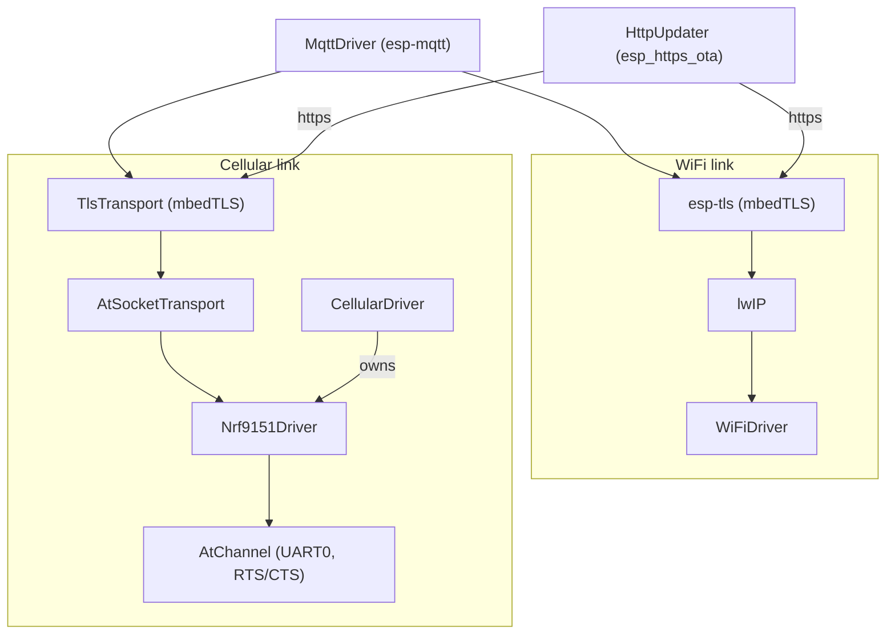

# Connectivity

A device reaches the MQTT broker, and downloads firmware updates, over one of two links:

- **WiFi**, on every board (Spinach and Carrot).
- **Cellular** (LTE-M or NB-IoT), through the Nordic nRF9151 on the Desert Lark MK2 daughter board:
  Carrot builds on MK14 boards only.

The link is chosen at boot from network-config, and only that link's driver is started. Both
drivers report the same network states, so MQTT, telemetry and the rest of the firmware don't need
to know which link is in use.

This document describes how both links work today. The decisions behind the cellular link, what
was measured on Desert Lark MK2, and what's left are in [`specs/Desert-Lark-MK2.md`](specs/Desert-Lark-MK2.md).
The cellular link started out on NB-IoT, with a Quectel BC660K-GL on Desert Lark MK1 (MK13 boards,
now WiFi only); that work's design history and bench measurements are in
[`specs/abandoned/NB-IoT.md`](specs/abandoned/NB-IoT.md).

## Overview



TLS follows the URL's scheme on both links: an `http://` firmware URL is fetched unencrypted, with
no certificate check.

| | WiFi | Cellular |
| --- | --- | --- |
| Platforms | Spinach, Carrot | Carrot, MK14 boards |
| Driver | `WiFiDriver` | `CellularDriver`, `Nrf9151Driver` |
| IP stack | lwIP | The modem's own, through AT socket commands |
| TLS | esp-tls | `TlsTransport`, mbedTLS over the AT socket |
| Time | SNTP | NITZ from the network, SNTP over a modem socket as a fallback |
| Telemetry section | `wifi` | `cellular` |

## Choosing the link

The `links` field in network-config lists the links to use, in order of preference. For now
exactly one entry is supported:

```json
"links": ["cellular"],
"cellular": {
  "rats": ["lte-m", "nb-iot"],
  "edrxCycle": 0
}
```

`chooseNetworkLink()` (`NetworkLink.hpp`) turns it into a link:

| `links` | Link | Logged |
| ------- | ---- | ------ |
| missing or empty | WiFi | nothing, as every device did before the field existed |
| `["wifi"]` | WiFi | |
| `["cellular"]` on a device with a modem | Cellular | |
| `["cellular"]` on a device without one | WiFi | an error |
| more than one entry, or an unknown one | WiFi | an error |

A device has a modem only on Carrot builds (`UD_PLATFORM_CARROT`, set by CMake), and only on boards
whose device definition returns modem pins (`DeviceDefinition::getCellularModemPins()`, which only
MK14 overrides). The `cellular` section holds the modem settings and is only used on the cellular
link:

- `rats`: the radio access technologies to use, in order of preference, `"lte-m"` and `"nb-iot"`.
  Missing or empty means both, LTE-M first (see [Startup](#startup)).
- `edrxCycle`: see [Sleep](#sleep).

Changing the link reboots the device, like any other network-config change. Network-config also
carries the device's client key, so every change to `links` comes with a freshly issued client
certificate and key. A link change is confirmed as soon as the device boots with it, so switching a
device without coverage to `cellular` leaves it unreachable until someone gets to it.

`initConnectivity()` (`Connectivity.hpp`) starts the chosen link's driver, along with an `RtcDriver`
set up for that link. The result is a `ConnectivityDrivers` struct. In it, the other link's driver
is `nullptr`, and `modemTransport` holds the transport that MQTT and updates use over cellular
(`nullptr` on WiFi, meaning lwIP). The BOOT message reports the link in use as `connectivity`.

### Network states

Both drivers set the same two states in `ModuleStates`. `MqttDriver` waits for `networkReady`
before every connection attempt.

| State | WiFi | Cellular |
| ----- | ---- | ------ |
| `networkConnecting` | Set while connecting | Set from modem start until registered with an IP address, and again when registration is lost |
| `networkReady` | Set on `IP_EVENT_STA_GOT_IP`, cleared on disconnect or lost IP | Set once registered with an IP address, cleared when registration is lost |

The status LED blinks every 200 ms while `networkConnecting` is set.

## WiFi

`WiFiDriver` runs the station on its own `wifi-driver` task.

### Credentials and provisioning

The device connects to a single network, whose credentials the WiFi stack keeps in flash. They
don't come from network-config. There are two ways to set them:

- **Over BLE** (Carrot): the custom *Ugly Duckling Service* (`BleDriver`) has characteristics for
  - scan results;
  - status: `unconfigured`, `connecting`, `connected`, `disabled`, or `failed:<reason>`;
  - credentials, as `{"ssid", "password"}`;
  - control: `scan`, `disconnect`, `disable`.

  New credentials are stored, and the driver reconnects with them.
- **SoftAP provisioning**: with no stored credentials, the driver starts IDF's network provisioning
  (`network_provisioning`). The access point is named `PROV_` plus the last three bytes of the MAC,
  and uses security 1 with a fixed proof of possession. It runs until credentials arrive; there is
  no timeout. This is the only way on Spinach, which has no BLE.

Holding the BOOT button for 5 s forgets the WiFi credentials (`esp_wifi_restore()`) and reboots;
30 s erases all of NVS.

### Connecting

With credentials, the driver connects and waits up to 1 minute for an IP address before starting
over. A disconnect starts the next attempt straight away; there is no backoff. Each attempt stops
and restarts the WiFi stack. `disconnect` over BLE drops the connection and reconnects; `disable`
keeps WiFi off until new credentials arrive.

The address comes from DHCP. The lease's NTP server is used too (see [Time](#time)). The
`hostname` the driver is given isn't applied to the netif, so DHCP sees IDF's default hostname.

### Power saving

With `sleepWhenIdle` (device-config, on by default) the station uses `WIFI_PS_MAX_MODEM` and wakes
for every 20th beacon (`listen_interval`); otherwise `WIFI_PS_MIN_MODEM`. RAM and sleep tuning for
Carrot is in `sdkconfig.carrot.defaults`:

- 6 static RX buffers instead of 10;
- WiFi code kept out of IRAM;
- a warning not to enable `CONFIG_ESP_WIFI_ENHANCED_LIGHT_SLEEP`, which stops light sleep
  altogether when BLE is on.

### Telemetry

The `wifi` section has `rssi` (while connected) and `disconnects` (since the last telemetry
message).

## Cellular

### Hardware

Desert Lark MK2 carries a Nordic nRF9151 (LTE-M and NB-IoT) running Nordic's
[Serial Modem](https://github.com/nrfconnect/ncs-serial-modem) 2.0 firmware, with the nRF91M1's pin
map: hardware flow control is always on, and the UART starts at 115200 baud on every boot. It
plugs into MK14's JMODEM1 (`UglyDucklingMk14Rev1::getCellularModemPins()`):

| Signal | ESP32-C6 | Notes |
| ------ | -------- | ----- |
| TX → modem RX | GPIO16 | UART0 |
| RX ← modem TX | GPIO17 | UART0 |
| RTS → modem CTS | GPIO21 | |
| CTS ← modem RTS | GPIO20 | Pulled up here, as Serial Modem asks of the host |
| DTR# → modem | GPIO15 | Low keeps the modem's UART on; Desert Lark pulls it up |
| RI# ← modem | GPIO3 | Low when the modem has something to say while its UART is off |
| RESET# → modem nRESET | GPIO4 | Open-drain only: pulled low or released, never driven high, no pull-up |

The modem runs on UART0 (UART1 is RS485's on MK14), clocked from the 40 MHz crystal. The console
is on USB Serial/JTAG. A debug build with `-DUD_UART0_CONSOLE=1` puts the console back on UART0;
the cellular driver then leaves the modem alone and the device runs offline.

MK13's BC660K-GL Desert Lark is no longer supported: MK13 boards run on WiFi.

### Layers

```text
CellularDriver              ← startup, registration, network states, time, telemetry
  └─ CellularModuleDriver   ← chipset-specific AT: settings, sockets, URCs, NTP
       └─ Nrf9151Driver     ← Serial Modem's #X* commands, %XMONITOR, DTR/RI and reset
            └─ AtChannel    ← UART with flow control: commands, responses, URC lines
AtSocketTransport           ← esp_transport over the modem's socket commands
TlsTransport                ← mbedTLS over any esp_transport
```

`AtChannel` owns the UART: a reader task splits what the modem sends into lines, and hands them to
the command in flight, or, for lines that are URCs (`Nrf9151Driver::isUrc()`) and everything
between commands, to the URC handler. A command that times out still gets answered eventually; the
next command first waits for that late result, so it isn't taken for its own. The parsers
(`AtResponse.hpp`, `AtSocket.hpp` and the others next to them) are unit-tested natively, against
lines captured from the modem.

### Startup

`CellularDriver` runs on its own `cellular` task:

1. **Find the modem** at 921600 baud, then at 115200, retrying for a few seconds while it boots. An
   ESP32 restart doesn't restart the modem, so it can still be on the fast rate. If it answers at
   115200, switch it with `AT+IPR=921600` (not saved: it's back at 115200 after every modem boot).
   If it doesn't answer at all, pulse nRESET and try again.
2. **Apply settings sent on every boot** (Serial Modem keeps none of them):
   - `AT+CMEE=1`;
   - `AT+CEREG=5` (registration URCs with the reject cause and the PSM timers);
   - `AT+CSCON=1` (RRC state URCs), `AT%MDMEV=1` (modem events, logged);
   - `AT%XTIME=1` (network time), `AT#XAPOLL=,1,1` (socket announcements, see [Sockets](#sockets));
   - `AT#XCLOSE`, for sockets an earlier boot left open.
3. **Choose the RATs**: `AT%XSYSTEMMODE` from `cellular.rats` (`1,1,0,1` for both with LTE-M
   first, GNSS off). The modem keeps it in flash; it's only written when it differs, with the radio
   off (`AT+CFUN=4`), since a change costs a detach and a fresh network search.
4. **Release assistance** on (`AT%RAI=1`), then the radio (`AT+CFUN=1`; Serial Modem starts at 0).
5. **Power saving**: PSM off (`AT+CPSMS=0`), eDRX as configured (see [Sleep](#sleep)).
6. **Log** the Serial Modem and modem firmware versions, IMEI, ICCID, IMSI and system mode, attach
   the modem to the socket transport, and start monitoring the network.

If the modem restarts later (Serial Modem says `Ready`), or stops answering (3 commands in a row
time out, at most once every 10 minutes it's then reset through nRESET), the next command runs
steps 1–5 again, and an open socket is reported closed. If the modem doesn't answer at startup,
the driver logs an error and the device stays offline. It doesn't fall back to WiFi.

### Registration

The network monitor reads `AT+CEREG?` every 30 s while searching and every 5 minutes once the
network is ready and the time is set. A `+CEREG` URC triggers a read straight away. Each check also
reads:

- the serving cell (`AT%XMONITOR`: RAT, operator, cell, band, EARFCN, PCI, RSRP, SNR; and once
  camped `AT%CONEVAL`: RSRQ, coverage enhancement level, transmit power);
- the RRC state (`AT+CSCON?`);
- once registered, the eDRX grant (`AT+CEDRXRDP`), logged when it changes.

While searching, it also logs `AT+COPS?`. A refused registration shows in the `+CEREG` URC as an
EMM cause, e.g. 15 (*no suitable cells in tracking area*) from a network that doesn't take the
SIM on that RAT; the modem then tries elsewhere by itself.

The network is ready once the modem is registered (home or roaming) *and* PDP context 0 has an
address (`AT+CGPADDR=0`). The APN, DNS servers and MTU the network handed out are logged
(`AT+CGCONTRDP=0`). Losing registration clears `networkReady` again.

### Sockets

`AtSocketTransport` is an `esp_transport` over the modem's TCP socket commands. Both esp-mqtt and
the HTTP client accept it in place of lwIP. There's one connection at a time.

- **Connecting**: `AT#XSOCKET=1,1,0` (the handle it returns starts at 1), then
  `AT#XCONNECT=<handle>,"<host>",<port>` with the hostname directly; the modem resolves it.
- **Sending**: `AT#XSEND=<handle>,1,0,"<hex>"`, up to 1400 bytes per command.
- **Receiving**: the modem keeps received data, and announces it with `#XAPOLL: <handle>,1`
  (POLLIN). It announces again only once a read has found the socket drained, so the transport
  reads with `AT#XRECV=<handle>,1,64,0,2048` (hex, non-blocking) until a read comes back empty
  (`ERROR`, for EAGAIN). It also reads every 30 s without an announcement, in case one got lost.
  The modem's TCP stack holds what we haven't read and throttles the peer, so nothing is lost
  while the ESP32 is busy, e.g. writing flash during an update.
- **Closing**: `#XAPOLL: <handle>,16` (POLLHUP) means the peer or the network closed it; a read
  then answers a bare `OK` once everything has been read. We close with `AT#XCLOSE=<handle>`.
- **Releasing the radio**: once an exchange ends with data received and nothing more for 5 s
  (a PUBACK or PINGRESP answered what we sent), the transport sends
  `AT#XSOCKETOPT=<handle>,1,61,1` (`RAI_NO_DATA`), so the modem leaves RRC connected mode right
  away instead of when the network's inactivity timer runs out. After a send, it's left to the
  network's timer, since an answer is probably on its way. A wrong guess only costs a new
  connection.

Socket data is hex in both directions, so it travels as ordinary text lines through the same
command and URC handling as everything else. That doubles the bytes on the UART, which at 921600
baud still leaves it faster than LTE-M.

The transport logs a summary when each connection closes: duration, bytes each way, how much the
safety poll found, data announcements and UART errors.

### Sleep

The modem stays reachable for commands, so PSM is off. eDRX is configurable in network-config:
`cellular.edrxCycle` is in milliseconds, one of the eDRX cycles (on LTE-M 5120, 10240, 20480,
40960, 61440, 81920 ms and up; on NB-IoT 20480, 40960, 81920 ms and up), and it's requested on each
RAT that has it (`AT+CEDRXS=2,<4 or 5>,"<code>"`). The default is 0, which turns eDRX off
(`AT+CEDRXS=0`): commands should arrive within seconds. Without eDRX the modem listens every
paging cycle the cell broadcasts (1.28–10.24 s). What the network grants is logged; on the bench,
One HU granted 81.92 s on LTE-M to an Onomondo SIM.

Serial Modem turns its UART off while DTR is deasserted, which saves about 0.4–0.6 mA. So:

- DTR is asserted, and the ESP32 held out of light sleep, while commands run and for 100 ms after
  the last byte either way; then it's deasserted, and the ESP32 can sleep.
- When the modem has something to say while its UART is off (an `#XAPOLL` for received data, a
  `+CEREG`), it asserts RI. RI wakes the ESP32 from light sleep (a low-level GPIO wake-up, armed
  once the modem is up, since RI floats while it boots), which asserts DTR. The modem releases RI
  once its UART is up, and sends what it held back.
- With flow control on both sides, nothing sent either way is lost to a sleeping UART.
- RI that stays low for 2 s (a modem stuck in reset) is taken out of the wake-up sources until it
  goes high again, so it doesn't keep the ESP32 awake.

On update boots DTR stays asserted, and the ESP32 awake, throughout.

### Telemetry and the debug console

The `cellular` telemetry section has:

- the serving cell's `cell`, `rat` (`lte-m` or `nb-iot`), `band`, `rsrp`, `rsrq`, `sinr` and
  `ecl`, as of the last registration check;
- `bytes-sent` and `bytes-received` over the modem;
- `rrc-releases`, how many times release assistance was sent after an exchange (see
  [Sockets](#sockets));
- `rrc-idle-ratio` and `rrc-connections`;
- `rrc-longest-connected`, the longest RRC connection in seconds (one still open counts as far as
  it got);
- `rrc-missed-changes`, the RRC state changes that no `+CSCON` URC reported, only the periodic
  `AT+CSCON?` read found. Until that read, the time was counted in the wrong state, so the RRC
  fields are only as accurate as this count is low.

The byte and RRC counts cover the time since the last telemetry message.

In `UD_DEBUG_CONSOLE` builds, the console shows a `cellular:` line in place of `WIFI:`, with the
registration state or IP address, `CONN`/`IDLE` for the RRC state, the RAT, RSRP and ECL. It shows
what the last registration check saw (`CellularDriver::getStatus()`), rather than sending commands.

## Time

Boot waits for the RTC to be in sync before setting up peripherals (see
[Time acquisition](Architecture.md#time-acquisition)). Each link brings its own source; on both,
time kept across a soft reset counts, and a BLE central can set the time through the Current Time
Service (Carrot).

- **WiFi**: SNTP. The client starts once the network is ready and lives for the lifetime of the
  device. It uses the DHCP lease's server, then `ntp.host` from network-config, then
  `pool.ntp.org`.
- **Cellular**: NITZ, which the network sends with an attach, as `%XTIME` (UTC, in semi-octets).
  If none came 30 s after the network is ready, the driver asks `ntp.host` (or `pool.ntp.org`)
  with SNTP over a UDP socket of the modem's (`AT#XSENDTO`, `AT#XRECVFROM`), since Serial Modem
  has no NTP command. It retries every 5 minutes, then re-syncs once a day.

## MQTT over each link

`MqttDriver` uses esp-mqtt on both links. Over cellular it gets the transport stack in
`config.network.transport`. esp-mqtt then ignores the URI's scheme, so the driver builds the stack
to match it:

- `AtSocketTransport`;
- `TlsTransport` on top, for `mqtts` and `wss`;
- IDF's WebSocket transport on top of that, for `ws` and `wss`.

| | WiFi | Cellular |
| --- | --- | --- |
| Transport | esp-mqtt's own, from the URI | The stack above |
| TLS | esp-tls, verifying against `serverCert` | `TlsTransport`, verifying against `serverCert` (required), hostname checked |
| Client certificate | `clientCert` / `clientKey`, if set | The same |
| Keepalive | 120 s | 10 minutes (a ping every 5 minutes), for the SIM's data budget |
| Network timeout | 15 s | 30 s |
| Resend of an unacknowledged message | after 5 s | after 1 minute, since TCP already delivers it and every resend goes over the air |
| esp-mqtt task stack | IDF default | 8 KB, for TLS on top of the AT layer |

On both links, sessions are always clean, so subscriptions are made again on every connect. The
buffers are 8 KB in and 4 KB out.

Messages wait in esp-mqtt's outbox until the broker acknowledges them, and a reconnect sends again
whatever is still there. The outbox drops a message 10 minutes after it was queued or first sent
(`CONFIG_MQTT_OUTBOX_EXPIRED_TIMEOUT_MS`, 30 s by default), long enough to outlast an NB-IoT
reconnect, and holds at most 16 KB. What doesn't fit, e.g. the boot's log records while an NB-IoT
connection is still coming up, waits in `MqttDriver`'s own queue, in order, until acks or expiry
make room. That queue doesn't expire, but holds at most another 16 KB; past that, new messages are
dropped.

Plain `mqtts` costs the least over cellular: WebSocket adds an HTTP upgrade per connection and a few
bytes per packet.

**A broker behind Tailscale Funnel keeps the radio connected.** Funnel (in front of the
`mosquitto-home` bench broker) accepts connections on Go servers, which send TCP keepalives: a probe
after 15 s idle, then every 15 s. Each probe is a downlink packet that pages the modem and restarts
the network's RRC inactivity timer, so the radio never goes RRC idle, even in a release build with
no MQTT traffic. None of it shows in the byte counters. On the BC660K, moving to the staging broker
(not behind Funnel) dropped the battery current from about 29 mA to 19 mA. So measure power,
`rrc-idle-ratio` and the carrier's NAT idle timeout against a broker without TCP keepalives, and
check any production endpoint for them too. Debug builds also keep the radio connected on any
broker: they keep the ESP32 awake and publish their logs.

## Firmware updates

`HttpUpdater` downloads updates with `esp_https_ota` on both links:

1. A `firmware` entry in UPDATE, or the `update` command, stores the URL in NVS and reboots.
2. The next boot downloads and installs the image, then reboots either way. A failed attempt is
   reported in BOOT and SYNC after that reboot.

The update boot holds the CPU at full speed and keeps the ESP32 out of light sleep. BLE isn't
started.

| | WiFi | Cellular |
| --- | --- | --- |
| MQTT during the download | Running; the update waits up to 15 s for it, so logs are published | Not started: the download needs the modem's single socket. Only the serial console has logs |
| Waiting for the network | 15 s | 5 minutes |
| Transport | lwIP, esp-tls | `AtSocketTransport`, `TlsTransport` on top for HTTPS |
| Certificate check | CA bundle | CA bundle (`TlsTransport` without credentials) |
| HTTP read timeout | HTTP client default | 30 s |
| Range size | 256 KB | 64 KB, about 30 s each |

**Ranges.** The image is fetched in ranges over one keep-alive connection
(`CONFIG_ESP_HTTPS_OTA_ENABLE_PARTIAL_DOWNLOAD`):

1. `esp_https_ota` asks for the image size with a `HEAD` request, on a connection of its own.
   Over NB-IoT, that's an extra TLS handshake of about 5 s, on every attempt; LTE-M is quicker.
2. It requests one range at a time, on the same connection.

Ranges cost a request each, but a download that breaks off then picks up where it left off. WiFi
takes the same path, so updates over WiFi on the bench exercise it. Progress is logged every
128 KB, against the image size.

**Resuming.** A download that breaks off is resumed in the same boot, after 2 s, from what made it
to flash. A TLS record that lost data fails its MAC check and never reaches the image, so
everything written is good. It gives up after 3 attempts in a row that got no further. An HTTP
error status is only final before anything has been written: once part of the image is in
flash, an error on a later range counts as a broken-off download, and is retried like one. An
image that's refused (not a valid image, not for this chip or flash mode, or too large for the
partition) isn't downloaded again. Each
attempt starts with its own `HEAD` request, so over cellular a resume costs two TLS handshakes.
Across a reboot, a download starts over.

The CA bundle is copied to internal RAM for the whole attempt (`RamCertBundle`, about 16 KB, a
workaround for an ESP32-C6 erratum until IDF v6.1.1): besides `esp_https_ota_begin()`, a new
connection for the next range needs it whenever the server doesn't keep the last one alive. The task
watchdog is fed with every chunk received.

## Known gaps

- **No fallback between links.** A device on cellular whose modem doesn't answer stays offline, and a
  link change is confirmed before MQTT has connected over the new link (stage 4 of
  [`specs/abandoned/NB-IoT.md`](specs/abandoned/NB-IoT.md)).
- **`links` must be an array.** A plain string such as `"links": "cellular"` is ignored without an
  error, and the device uses WiFi.
- **The hostname isn't applied** to the WiFi netif.
- **No band lock.** The modem searches every band it supports, which can take minutes on a first
  attach in a new area.
- **Some downloads end early.** On the bench (Onomondo on One HU, LTE-M), 3 of 12 plain-HTTP
  downloads of 64 KB ended 5672 bytes short, each time at the same offset, with a clean close
  (`#XAPOLL` POLLHUP, then end of stream): the data never reached the modem's socket. Curl over
  the wired network never truncated. The cause (server, operator or modem) is unknown. For
  updates, TLS catches the gap and the download resumes (see [Firmware updates](#firmware-updates)).
- **ESP32 light sleep on cellular is untested on MK14 hardware.** DTR gating and RI work (MK14's
  first run, a debug build), but no release build has run yet, so the light-sleep wake-up on RI,
  the battery current and RRC idle are still to be measured (see
  [`specs/Desert-Lark-MK2.md`](specs/Desert-Lark-MK2.md#mk14)).
- **SoftAP provisioning** is open, uses a fixed proof of possession, and has no timeout.
- **On cellular, BLE still advertises the WiFi provisioning service.** Writes to it are ignored.
- **Clean sessions only**, so QoS 1 messages sent while the device was away are lost (#682).
- **Updates over cellular can't resume across a reboot**, and each costs about 2 MB of the SIM's
  data budget. The planned replacement sends the image in chunks over MQTT
  ([cornucopia-app#535](https://github.com/cornucopia-machines/cornucopia-app/issues/535)).

## Alternatives not taken

For the reasoning behind the current design, see [`specs/Desert-Lark-MK2.md`](specs/Desert-Lark-MK2.md);
for the NB-IoT era's, and its measurements, [`specs/abandoned/NB-IoT.md`](specs/abandoned/NB-IoT.md).

- **PPP to the modem, with lwIP on top** (Serial Modem has `AT#XPPP` and CMUX). It would make the
  modem look like any other netif, but needs CMUX to keep AT commands for registration and status
  alongside, and lwIP in cellular builds. The AT socket transport was already there.
- **The modem's own MQTT client** (`AT#XMQTT*`), and TLS in the modem (`AT#XSSOCKET`). They'd be a
  second MQTT stack next to esp-mqtt, with its own QoS, reconnect and payload limits, and
  certificates stored in the modem. Over our own AT socket transport, the bytes on the wire are the
  same as over WiFi, and certificates are handled the same way.
- **Binary data mode** (`AT#XSEND=<handle>,2,...`, `#XRECV` in binary) instead of hex. Half the
  bytes on the UART, but raw data in the middle of the line protocol; at 921600 baud the UART
  isn't the bottleneck.
- **Pushed data** (`AT#XRECVCFG`) instead of announcements and reads. With the modem buffering
  and flow control on the UART, reading on demand loses nothing, and keeps commands and data apart.
- **PSM instead of eDRX.** PSM sleeps deeper (about 2.7 µA vs 18–32 µA in eDRX), but the device
  would be unreachable for commands between its own wakes. The ESP32, not the modem, dominates the
  power budget anyway.
- **Ranged downloads only over cellular.** They'd save WiFi an extra request, but one path for both
  links means updates over WiFi exercise what cellular devices rely on.
