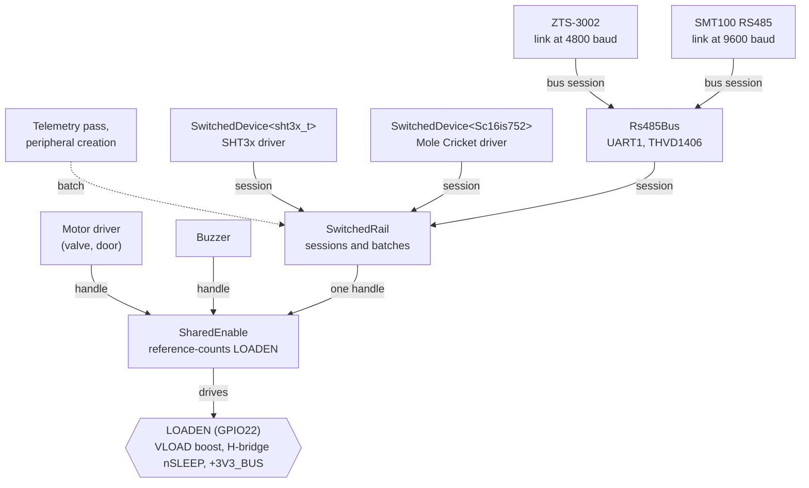

# Sensor power

How the firmware powers the sensor ports on boards that can switch them (MK14 on), and how a
sensor driver gets power. For wiring and configuring the sensors themselves, see
[`peripherals/README.md`](peripherals/README.md).

## Switched sensor supply

From MK14 on, the external I²C port and the RS485 transceiver run off `+3V3_BUS`, a load switch on
LOADEN (GPIO22). The same pin enables the 6.5 V VLOAD boost and wakes the H-bridge, so the sensor
ports are powered exactly when LOADEN is. Earlier boards power their sensors all the time.



Three classes in `kernel/drivers` build on each other:

- **`SharedEnable`** owns the pin. Every client (motor driver, buzzer, sensor supply) holds a
  handle. LOADEN is on while any handle is acquired, and goes off when the last one is released.
  `acquire()` returns once LOADEN has been on for the 5 ms settle time, so a client that comes in
  while LOADEN is already on only waits for whatever remains of it.
- **`SwitchedRail`** is the sensor supply. Peripherals reach it as `PeripheralServices::switchedRail`
  and hold a `Session` while they talk to a sensor. Each session also tells the sensor driver which
  power-up it runs in (its *activation*), and `waitPoweredFor()` waits out a sensor's own start-up
  time. Time the rail has already been on, for any client, counts towards that wait. MK14 creates
  the rail from its LOADEN `SharedEnable`; every other board uses `SwitchedRail::alwaysOn()`, whose
  sessions never wait and whose activation never changes.
- **`SwitchedDevice<T>`** wraps one sensor on the rail. It owns whatever the driver talks to the
  sensor through (an I²C descriptor, an `I2CDevice`, a bridge chip), and hands it out only from
  `power()`, so a driver built on it can't reach its sensor without powering the rail: forgetting
  to, which would still work on MK13 but fail on MK14, doesn't compile. `power()` opens a session, waits for the sensor's
  start-up time, and re-runs the driver's power-on setup whenever the activation has changed since
  it last ran, because sensors lose their settings when the rail goes off. On an always-on rail
  that setup runs exactly once, at creation, as it did before. `unpowered()` gives access without
  power, only for setting up and freeing the driver's own descriptor.
- **`Rs485Bus`** is the board's RS485 port, which every RS485 probe shares (see
  [RS485 sensors](#rs485-sensors)). It isn't a `SwitchedDevice`: each of its sessions takes a rail
  session of its own.

A `Batch` keeps the rail on between sessions without turning it on by itself. Peripheral creation
and each telemetry pass run inside one, so all the sensors share one power-up, and a device with
no sensors on the rail never turns it on.

## One reading

What happens when a telemetry pass reads a sensor on MK14 while the rail is off:

1. The telemetry pass opens a batch. Nothing switches on yet.
2. The first sensor's driver calls `switchedDevice.power()`. Its session takes the rail's handle on
   LOADEN, which turns LOADEN on (unless the valve or buzzer already has it), and waits for the
   5 ms settle time.
3. `power()` waits until the rail has been on for the sensor's start-up time, then sees a new
   activation and runs the sensor's power-on setup.
4. The driver talks to the sensor through the guard `power()` returned. When the guard goes out of
   scope, the session ends, but the batch keeps the rail on.
5. The next sensors find the rail on: they only wait for whatever is left of their own start-up
   time, then run their setup, since this is a new activation for them too.
6. The batch ends with the telemetry pass, releasing the rail's handle. LOADEN goes off unless the
   valve or buzzer still holds it.

The next pass is a new activation, so every sensor is set up again. On boards whose rail is always
on, steps 2, 3 and 6 do nothing, and setup only ever runs at creation.

## Writing a driver for a port sensor

Any peripheral on the external I²C port should be built on `SwitchedDevice` (for RS485 probes, see
[RS485 sensors](#rs485-sensors)), using `PeripheralServices::switchedRail`:

```cpp
// Member: owns the descriptor; the lambda runs after every power-up
SwitchedDevice<sht3x_t> switchedDevice;

// Constructor
, switchedDevice(rail, POWER_UP_TIME, [](sht3x_t& sensor) -> Result<> {
    ESP_TRY(sht3x_init(&sensor));
    return {};
})

// Creating the sensor: set up the descriptor without power, then power it once to find out early
// whether it answers
ESP_TRY(sht3x_init_desc(&sensor->switchedDevice.unpowered(), ...));
TRY(sensor->switchedDevice.initialize());

// Reading it
auto device = TRY(switchedDevice.power());
TRY(device->readRegWord(...));
```

- Pass `NO_POWER_ON_SETUP` instead of the lambda when the sensor keeps no settings we change.
- Extra arguments after the setup construct the `T` in place, e.g. an `I2CDevice` or a bridge chip.
- A `T` that is a smart pointer is reached through: `device->readReg(...)` on a
  `SwitchedDevice<std::shared_ptr<I2CDevice>>`.
- Where a read turns errors into NaN instead of returning a `Result`, check the result of
  `power()` and use `(*device)->...`.
- Use `unpowered()` only for setting up and freeing the driver's own descriptor, never to talk to
  the sensor.
- Keep the guard for as long as the sensor has to stay powered, e.g. while waiting for a
  measurement to finish.

| Peripheral | Start-up wait | Set up again after each power-up |
| --- | --- | --- |
| SHT3x | 1.5 ms | Status cleared |
| SHT2x / HTU2x | 15 ms | Nothing to set up |
| HDC2010 | 3 ms | On-demand mode |
| Chirp | 1 s | Nothing to set up |
| Spadefoot Toad | 100 ms | Nothing to set up (settings in its EEPROM) |
| BH1750 | none | Continuous mode, then one 24 ms measurement |
| TSL2591 | none | Gain and integration time, then one 300 ms integration cycle |
| Mole Cricket (SMT100) | none | UARTs and GPIOs; the probe's own 500 ms start-up follows |
| ZTS-3002 (RS485) | 1 s | Nothing to set up |
| SMT100 (RS485) | 500 ms | Nothing to set up |

**Light sensors read once a minute by default.** BH1750 and TSL2591 run their own reading loop
instead of reading on demand, and every reading powers the rail.

**Valves and sensors share LOADEN without locking each other out.** The I²C sensors draw from
`+3V3_BUS`, which comes off the main 3.3 V rail, not off VLOAD, so a valve pulse during a reading
costs at most a failed reading. RS485 probes are different: the port's eFuse lets them draw up to
1 A from VLOAD, and that plus about 0.5 A of coil current exceeds the boost's worst case on a
depleted cell. The probes supported so far draw far less (the SMT100 ~5 mA, ~40 mA for under
50 ms), so this doesn't matter yet. RS485 sessions don't exclude valve moves
([#726](https://github.com/cornucopia-machines/ugly-duckling-firmware/issues/726));
`SwitchedRail::acquire()` is where they should start to.

## RS485 sensors

RS485 probes reach the board's port through `Rs485Bus` (MK14: UART1 behind the THVD1406) rather
than `SwitchedDevice`:

- **The bus is shared.** UART1 and the transceiver serve every probe on both ports, so no probe can
  own them. A session holds the bus's mutex for the whole exchange, because the bus is half-duplex
  and each probe needs the UART at its own baud rate. A `SwitchedDevice` only locks its power-on
  setup.
- **The pins follow the rail.** A session powers the rail first, then attaches the UART to the
  pins. It detaches them before it releases the rail: the transceiver's logic inputs pull up to its
  own supply, so an idle-high TX would back-power it while the rail is off. `SwitchedDevice` has no
  hook at the end of a session for that.
- **Nothing to set up again.** The UART's settings live in the ESP and survive the rail going off,
  and the probes we support keep theirs. A session also holds a no-light-sleep lock, since light
  sleep would stop the UART mid-frame.

A probe still can't be reached without powering the rail: the only way to an `ISerialPort` is
`ISerialLink::open()`, which takes a rail session.

The board provides the bus through `DeviceDefinition::getRs485Bus()`. MK14 creates its `Rs485Bus`
the first time a peripheral asks for it; on every other board the call fails, so an RS485 probe
fails to start there with a clear message. The RS485 factories (`soil:zts-3002`, and `soil:smt100`
with `bus: rs485`) are registered on every board and receive a `SerialBusProvider` that calls it.

A driver for an RS485 probe gets a link at its baud rate, then opens a session per reading:

```cpp
// Creating the sensor
auto bus = TRY(rs485());
auto link = bus->link(9600);

// Reading it
auto session = TRY(link->open());
// Counts the time the rail was already on, as with SwitchedDevice
session->waitPoweredFor(startupTime);
TRY(session->flushRx());
TRY(protocol->read(*session));
```

Protocols are written against `ISerialPort`, so the same code runs over Mole Cricket and RS485:
the SMT100's ASCII protocol uses both, and `ModbusRtu` is available to any Modbus probe.
