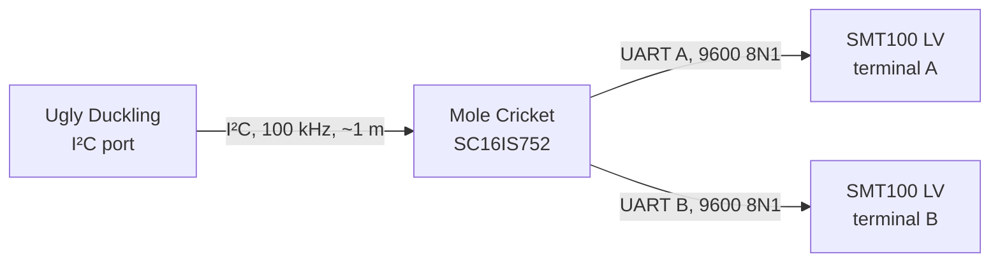

# Truebner SMT100 soil probe

The Truebner SMT100 measures the soil's volumetric water
content and temperature. It comes in several interface variants:

| Variant | Supported | How it connects |
| --- | --- | --- |
| LV UART | Yes | Through a [Mole Cricket](https://github.com/cornucopia-machines/mole-cricket-hardware) board on the I²C port |

## LV UART via Mole Cricket

The probe connects through Mole Cricket, an SC16IS752 I²C-to-dual-UART bridge, so that it works
with any Ugly Duckling that has an I²C port, including earlier boards. Mole Cricket has two probe
terminals, A and B, and a switch that powers the probes only while they are being read.



### Hardware support

| Ugly Duckling | Status |
| --- | --- |
| MK13 | Works: the I²C port is always powered |
| MK14 | Not yet: the I²C port's supply needs switching on for readings ([#713](https://github.com/cornucopia-machines/ugly-duckling-firmware/issues/713)) |

### Wiring

Connect Ugly Duckling's I²C port to Mole Cricket's J1 (push-in terminal) or J4 (PH2.0 socket).
Both keep Ugly Duckling's pin order: 1 GND, 2 +3V3, 3 SDA, 4 SCL.

Connect each probe to a 4-way sensor terminal:

| Pin | Signal | SMT100 LV wire |
| --- | --- | --- |
| 1 | Probe supply (switched 3.3 V) | Brown |
| 2 | GND | White |
| 3 | Mole Cricket TX → probe RX | Green |
| 4 | Mole Cricket RX ← probe TX | Yellow |

The probe lead can be up to 10 m long, Truebner's limit for the UART variant.

Set Mole Cricket's I²C address with the two jumpers on JP1. Both jumpers must be fitted:

| A1 | A0 | Address |
| --- | --- | --- |
| VDD | VDD | 0x48 (default in the firmware) |
| VDD | GND | 0x49 |
| GND | VDD | 0x4C |
| GND | GND | 0x4D |

### Configuration

Add one `soil:smt100` peripheral per probe. Probes on terminals A and B of the same Mole Cricket
use the same `sda`, `scl` and `address`, and share the board. For example, on MK13:

```json
{
  "peripherals": [
    {
      "name": "soil-a",
      "type": "soil:smt100",
      "params": {
        "sda": "EXT_SDA",
        "scl": "EXT_SCL",
        "channel": "a"
      }
    },
    {
      "name": "soil-b",
      "type": "soil:smt100",
      "params": {
        "sda": "EXT_SDA",
        "scl": "EXT_SCL",
        "channel": "b"
      }
    }
  ]
}
```

| Parameter | Default | Meaning |
| --- | --- | --- |
| `sda`, `scl` | (required) | I²C pins of the port Mole Cricket is on, e.g. `EXT_SDA`, `EXT_SCL` on MK13 |
| `address` | `0x48` | Mole Cricket's I²C address, as set by JP1 (a string, e.g. `"0x49"`) |
| `channel` | `a` | The terminal the probe is on: `a` or `b` |
| `probeAddress` | `000000` | The probe's address (up to 6 digits). `000000` is the broadcast address, which works as long as there is one probe per terminal |
| `protocol` | `ascii` | The probe's protocol. Only `ascii` is supported |
| `startupTime` | `500` | Milliseconds to wait after powering the probe before querying it. Truebner gives < 500 ms; 100 ms worked on the bench |
| `responseTimeout` | `500` | Milliseconds to wait for each answer from the probe. `GetTemperature` takes ~330 ms, so 200 ms is too short |

The I²C clock is always 100 kHz for Mole Cricket; `clkSpeed` is ignored.

Templates: [`smt100-mole-cricket-mk13.json`](../../config-templates/smt100-mole-cricket-mk13.json)
(one probe) and
[`smt100-mole-cricket-mk13-double.json`](../../config-templates/smt100-mole-cricket-mk13-double.json)
(two probes).

### Telemetry

Each probe publishes two features under its peripheral name:

| Feature | Unit | Value |
| --- | --- | --- |
| `moisture` | % | Volumetric water content |
| `temperature` | °C | Soil temperature |

If a reading fails (no probe, no answer, garbled answer), both values are `null` rather than the
last good reading, and the device logs a warning saying why.

### How a reading works

Every reading is a cold start, so the probes draw no current between readings:

1. Wake the terminal's UART on the bridge, switch the probe supply on, and light the status LED.
2. Wait `startupTime` for the probe to start, then discard anything it sent while starting.
3. Send `GetWaterContent!<probeAddress>` and `GetTemperature!<probeAddress>` in Truebner's ASCII
   protocol, and read each answer (a number followed by CR LF).
4. Switch the probe supply and LED off, and put the UART back to sleep.

Moisture and temperature come from the same reading. The two terminals share the probe supply and
Ugly Duckling's port supply is sized for one probe measuring at a time, so a reading on one
terminal waits for a reading on the other to finish.

At startup the firmware checks that Mole Cricket answers, and asks each probe for its firmware
version. A missing Mole Cricket fails the peripheral; a probe that doesn't answer is only a
warning, so it can be connected later.

Measured on MK13 with a short lead:

| Step | Time |
| --- | --- |
| `GetWaterContent` round trip | 117 ms |
| `GetTemperature` round trip | 330 ms |
| Probe powered per reading (500 ms start-up + queries) | ~950 ms |

### Troubleshooting

| Symptom in the log | Likely cause |
| --- | --- |
| `Mole Cricket not found` with I²C errors (NACK) | Cable, or JP1 doesn't match `address` (e.g. both jumpers at GND is 0x4D, not the default 0x48) |
| `did not identify itself` at startup, then `failed to read: ... no response` | Probe not connected, green and yellow swapped, or `probeAddress` doesn't match the probe |
| `incomplete response` or `no terminator` | Noise on a long lead, or the probe answering while still starting; try a longer `startupTime` |
| `Unsupported SMT100 protocol` | `protocol` is not `ascii` |

### Limitations

- Only the ASCII protocol. A probe switched to Modbus with Truebner's tool won't answer.
- One probe per terminal: the protocol addresses probes, but each terminal is a separate line
  with its own UART.
- MK14 is not supported yet ([#713](https://github.com/cornucopia-machines/ugly-duckling-firmware/issues/713)).
