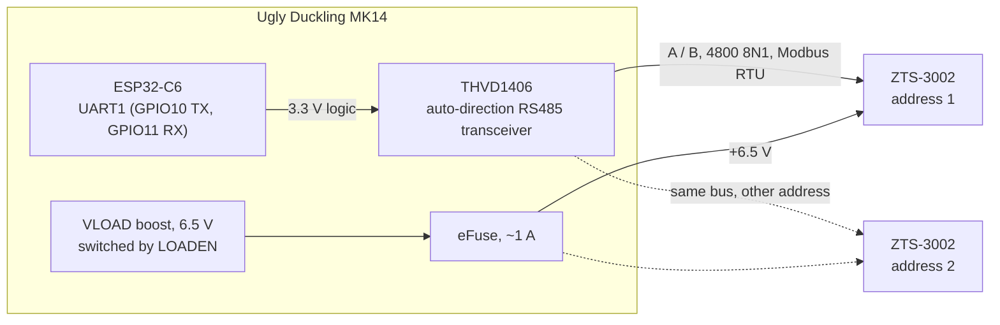

# ZTS-3002 soil multi-parameter sensor (RS485)

The ZTS-3002-TR-ECTHNPK-N01 is a three-pin soil probe that measures volumetric water content,
temperature and electrical conductivity, and reports nitrogen, phosphorus and potassium estimates.
It talks Modbus RTU over RS485 (the `N01` suffix). The same probe is sold under other names, e.g.
SN-3002-TR-ECTHNPKPH-N01; the variants with `PH` also measure pH, which the firmware doesn't read.

Datasheets: [`datasheets/zts_soil_ecthnpkph_n01.pdf`](../../datasheets/zts_soil_ecthnpkph_n01.pdf)
(ZTS manual) and [`datasheets/soil_5pin_ecthnpkph_n01.pdf`](../../datasheets/soil_5pin_ecthnpkph_n01.pdf)
(full register map); summary in
[`datasheets/notes/zts_soil_ecthnpkph_n01.md`](../../datasheets/notes/zts_soil_ecthnpkph_n01.md).

## Hardware support

| Ugly Duckling | Status |
| --- | --- |
| MK14 | On the board's RS485 port (UART1 behind an auto-direction THVD1406). The port and the probe are powered only while sensors are read ([sensor power on MK14](README.md#sensor-power-on-mk14)) |
| Earlier boards | Not supported: no RS485 port |

## Wiring

The probe connects straight to MK14's RS485 port; no adapter board is needed.



| Port pin | Signal | Probe wire |
| --- | --- | --- |
| 1 | +6.5 V (switched VLOAD; the probe takes 4.5–30 V DC) | Brown |
| 2 | GND | Black |
| 3 | RS485 A | Yellow |
| 4 | RS485 B | Blue |

Several probes can share the bus, each with its own Modbus address.

## Configuration

```json
{
  "peripherals": [
    {
      "name": "soil",
      "type": "soil:zts-3002",
      "params": {}
    }
  ]
}
```

| Parameter | Default | Meaning |
| --- | --- | --- |
| `address` | `1` | The probe's Modbus address (1–247). Probes sharing the bus need different addresses |
| `baud` | `4800` | The probe's baud rate: `2400`, `4800` or `9600` |
| `npk` | `false` | Also publish nitrogen, phosphorus and potassium (see below) |
| `startupTime` | `1000` | Milliseconds the probe must be powered before it is queried. Time the port was already on (e.g. for another sensor in the same telemetry pass) counts |
| `responseTimeout` | `500` | Milliseconds to wait for the probe's answer |

Template: [`plot-controller-mk14-zts-3002.json`](../../config-templates/plot-controller-mk14-zts-3002.json).

## Telemetry

| Feature | Unit | Value |
| --- | --- | --- |
| `moisture` | % | Volumetric water content |
| `temperature` | °C | Soil temperature |
| `conductivity` | µS/cm | Electrical conductivity |
| `nitrogen`, `phosphorus`, `potassium` | mg/kg | Only with `npk: true` |

**N, P and K are not measured.** The probe has no sensor for them: unless they are calibrated by
writing to the probe's registers, it computes them from the conductivity reading. They carry no
information beyond `conductivity`, which is why they are off by default.

If a reading fails, every value is `null` rather than the last good reading, and the device logs a
warning saying why.

## How a reading works

1. Take the RS485 bus (one sensor at a time), and power the port. On MK14 this switches LOADEN on,
   unless the rail is already on.
2. Attach the UART to the transceiver at the probe's baud rate, and wait until the port has been on
   for `startupTime`.
3. Read the holding registers from 0x0000: 3 of them (moisture, temperature, conductivity), or 7
   with `npk` (pH at 0x0003, unused, then N, P, K).
4. Detach the UART pins and release the port.

All values come from one Modbus request. The firmware doesn't read the probe at startup, so a
missing probe only shows up as a warning at the first telemetry pass.

## Troubleshooting

| Symptom in the log | Likely cause |
| --- | --- |
| `no response within ... ms` | Probe not connected, A and B swapped, or wrong `address` or `baud` |
| `CRC mismatch`, or `only N of M bytes` | Noise on the line, or another device answering at the same address |
| `exception illegal data address` | The probe doesn't have the requested registers; try without `npk` |

## Limitations

- Only reading. Changing the probe's address or baud rate, and calibration, need a Modbus tool.
- `npk` hasn't been tried on a real probe yet. Check that register 0x0003 reads 0 on the variants
  without pH, i.e. that N, P and K haven't moved down by one.
- Valve moves and RS485 readings don't exclude each other yet
  ([#726](https://github.com/cornucopia-machines/ugly-duckling-firmware/issues/726)). This probe's
  draw is small next to a valve pulse, so it doesn't matter here.
